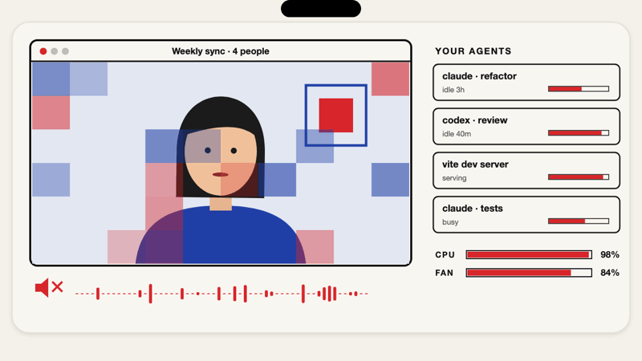
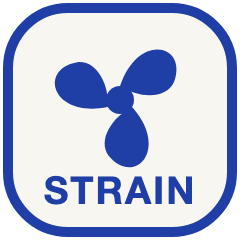
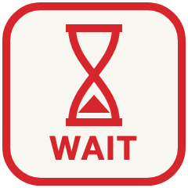

# Tamebar

Keeps your Mac calm while AI coding agents run.

```sh
curl -fsSL https://raw.githubusercontent.com/pFournet/tamebar/main/install.sh | sh
```
or `brew trust pfournet/tamebar && brew install --cask pfournet/tamebar/tamebar`



<table>
<tr><td></td><td>Watches real strain (fans, swap, heat), not just "memory warning".</td></tr>
<tr><td></td><td>Pauses idle agents and slows heavy jobs during calls and meetings, then resumes them.</td></tr>
<tr><td></td><td>New sessions wait while the Mac struggles; busy background work is slowed.</td></tr>
<tr><td></td><td>Everything it stops is listed with the command to bring it back.</td></tr>
</table>

`tamebar status` shows the same for you and your agents.

Local only, no telemetry · [Build from source](CONTRIBUTING.md) · MIT
